# Entity Relationship Diagram (ERD) & Database Specification
## E-Learning & Computer Based Testing (CBT) Platform Modern (LearnFlow)

Dokumen ini menyajikan spesifikasi arsitektur data komprehensif, desain skema relasional, pemanfaatan tipe data modern PostgreSQL 16+ (ULID, JSONB, tsvector), serta strategi pengindeksan performa tinggi (GIN & B-Tree) sesuai dengan panduan arsitektur pada file **Spesifikasi Tech Stack**.

---

## 1. Prinsip Desain Database PostgreSQL 16+

1. **Identifier ULID (Universally Unique Lexicographically Sortable Identifier)**:
   - Semua primary key menggunakan format ULID bertipe `CHAR(26)` atau `VARCHAR(26)` (contoh: `01HZX87K9WABCDEF0123456789`).
   - Mencegah *ID enumeration attack*, mengamankan endpoint API dari eksploitasi tebak ID lembar ujian, sekaligus menjaga performa B-Tree index karena terurut secara kronologis (time-sortable).
2. **Kolom JSONB Dinamis & Fleksibel**:
   - Struktur soal kuis/ujian bersifat sangat modular (`options`, `answer_keys`, `settings`, `metadata`) disimpan dalam kolom `JSONB`.
   - Tidak memerlukan alter table migrasi saat menambah model soal baru (Pilihan Ganda, PG Kompleks, Menjodohkan, Esai, Skala Likert).
   - Dipercepat dengan **GIN (Generalized Inverted Index)** untuk pencarian query JSONB secara instan.
3. **Pencarian Cepat Bawaan (Native Full-Text Search)**:
   - Menggunakan `to_tsvector('indonesian', ...)` dan `tsquery` pada judul materi, nama siswa, dan forum diskusi dengan GIN Index.
4. **Integritas Transaksional Tinggi (ACID)**:
   - Pengumpulan ujian massal serentak menggunakan `DB::transaction()` dengan pessimistic locking (`lockForUpdate()`) pada rekaman sesi ujian untuk mencegah *race condition* dan pengumpulan tumpang tindih.
5. **Audit Trail & Soft Deletes**:
   - Setiap mutasi nilai dan aksi krusial dicatat melalui tabel audit trail (`activity_log`), dan seluruh tabel akademik mengimplementasikan `deleted_at` (`softDeletes`).

---

## 2. Diagram Relasi Entitas Global (Mermaid ERD)

```mermaid
erDiagram
    %% Core & RBAC
    USERS ||--o{ USER_ROLES : has
    ROLES ||--o{ USER_ROLES : assigned_to
    ROLES ||--o{ ROLE_PERMISSIONS : grants
    PERMISSIONS ||--o{ ROLE_PERMISSIONS : belongs_to
    USERS ||--o| USER_PROFILES : has
    USERS ||--o{ PARENT_STUDENTS : guardian_of
    USERS ||--o{ PARENT_STUDENTS : ward_of

    %% Academic & Course Hierarchy
    INSTITUTIONS ||--o{ ACADEMIC_YEARS : has
    INSTITUTIONS ||--o{ COURSES : owns
    ACADEMIC_YEARS ||--o{ CLASS_GROUPS : contains
    COURSES ||--o{ COURSE_ENROLLMENTS : registers
    CLASS_GROUPS ||--o{ COURSE_ENROLLMENTS : enrolled_in
    USERS ||--o{ COURSE_ENROLLMENTS : user
    COURSES ||--o{ MODULES : structures
    MODULES ||--o{ LESSONS : contains
    LESSONS ||--o{ LESSON_ATTACHMENTS : attaches
    LESSONS ||--o{ LESSON_PROGRESS : tracks
    USERS ||--o{ LESSON_PROGRESS : achieves

    %% Question Bank & CBT Engine
    COURSES ||--o{ QUESTION_BANKS : provides
    QUESTION_BANKS ||--o{ QUESTIONS : contains
    QUESTIONS ||--o{ QUESTION_TAG_MAP : tagged_with
    QUESTION_TAGS ||--o{ QUESTION_TAG_MAP : categorizes
    
    COURSES ||--o{ EXAMS : conducts
    EXAMS ||--o{ EXAM_SECTIONS : consists_of
    EXAM_SECTIONS ||--o{ EXAM_QUESTIONS : includes
    QUESTIONS ||--o{ EXAM_QUESTIONS : mapped_to
    
    EXAMS ||--o{ EXAM_SESSIONS : generates
    USERS ||--o{ EXAM_SESSIONS : sits_for
    EXAM_SESSIONS ||--o{ STUDENT_ANSWERS : submits
    QUESTIONS ||--o{ STUDENT_ANSWERS : answers_for
    EXAM_SESSIONS ||--o{ EXAM_VIOLATIONS : logs_breach
    EXAM_SESSIONS ||--o| EXAM_GRADES : results_in

    %% Assignments & Manual Grading
    MODULES ||--o{ ASSIGNMENTS : offers
    ASSIGNMENTS ||--o{ ASSIGNMENT_SUBMISSIONS : receives
    USERS ||--o{ ASSIGNMENT_SUBMISSIONS : student
    ASSIGNMENTS ||--o{ RUBRIC_CRITERIA : defines
    ASSIGNMENT_SUBMISSIONS ||--o{ RUBRIC_EVALUATIONS : scored_by
    RUBRIC_CRITERIA ||--o{ RUBRIC_EVALUATIONS : based_on

    %% Discussion & Realtime
    COURSES ||--o{ FORUM_THREADS : hosts
    LESSONS ||--o{ FORUM_THREADS : context_for
    FORUM_THREADS ||--o{ FORUM_REPLIES : receives
    USERS ||--o{ FORUM_THREADS : authors
    USERS ||--o{ FORUM_REPLIES : posts
    
    %% Certification & Media & Audit
    COURSES ||--o{ CERTIFICATE_TEMPLATES : defines
    CERTIFICATE_TEMPLATES ||--o{ ISSUED_CERTIFICATES : issues
    USERS ||--o{ ISSUED_CERTIFICATES : recipient
    USERS ||--o{ ACTIVITY_LOGS : performs
```



---

## 3. Kamus Data & Spesifikasi Detail Tabel

### Domain 1: Identitas, RBAC, dan Profil Pengguna

#### 1. `users`
Tabel entitas otentikasi utama yang terhubung dengan Laravel Sanctum.
| Kolom | Tipe Data | Keterangan & Batasan |
| :--- | :--- | :--- |
| `id` | `CHAR(26)` | **PRIMARY KEY (ULID)**. |
| `institution_id` | `CHAR(26)` | FK -> `institutions.id`. Multi-tenancy support. Nullable jika Superadmin global. |
| `username` | `VARCHAR(50)` | UNIQUE, NOT NULL. Untuk login alternatif. |
| `email` | `VARCHAR(191)` | UNIQUE, NOT NULL. Indeks B-Tree. |
| `password` | `VARCHAR(255)` | NOT NULL. Hash Argon2id / Bcrypt. |
| `full_name` | `VARCHAR(150)` | NOT NULL. |
| `phone_number` | `VARCHAR(30)` | Nullable. Format internasional E.164. |
| `avatar_url` | `TEXT` | Nullable. URL CDN media profile (Cloudflare R2). |
| `status` | `VARCHAR(20)` | DEFAULT `'active'`. Nilai: `'active'`, `'suspended'`, `'pending'`. |
| `last_login_at` | `TIMESTAMPTZ` | Nullable. Catatan waktu login terakhir. |
| `last_login_ip` | `INET` | Nullable. Alamat IP login terakhir untuk keamanan. |
| `email_verified_at`| `TIMESTAMPTZ`| Nullable. Waktu verifikasi email. |
| `created_at` | `TIMESTAMPTZ` | Timestamp pembuatan baris data. |
| `updated_at` | `TIMESTAMPTZ` | Timestamp update baris data. |
| `deleted_at` | `TIMESTAMPTZ` | Nullable. Soft deletes. |

- **Indeks**:
  - `idx_users_email` (UNIQUE: `email`)
  - `idx_users_username` (UNIQUE: `username`)
  - `idx_users_fts` GIN on `to_tsvector('indonesian', full_name || ' ' || username)`

#### 2. `roles` & `permissions` (Spatie Multi-Tenancy Architecture)
| Tabel | Kolom Kunci | Keterangan |
| :--- | :--- | :--- |
| `roles` | `id (CHAR(26))`, `name (VARCHAR(50))`, `guard_name (VARCHAR(30))`, `institution_id (CHAR(26))` | Role sistem: `superadmin`, `instructor`, `teaching_assistant`, `student`, `parent`. |
| `permissions` | `id (CHAR(26))`, `name (VARCHAR(100))`, `guard_name (VARCHAR(30))` | Hak akses spesifik (misal: `exam.create`, `grade.revise`, `student.violation_view`). |
| `user_roles` | `user_id (CHAR(26))`, `role_id (CHAR(26))` | Tabel pivot polymorphic untuk penetapan role. |
| `role_permissions` | `role_id (CHAR(26))`, `permission_id (CHAR(26))`| Pivot hak akses ke role. |

#### 3. `parent_students`
Menghubungkan akun Wali Murid (*Parent*) dengan Siswa (*Student*) untuk pemantauan capaian nilai dan kartu ujian.
| Kolom | Tipe Data | Batasan |
| :--- | :--- | :--- |
| `id` | `CHAR(26)` | PRIMARY KEY (ULID). |
| `parent_id` | `CHAR(26)` | FK -> `users.id` (Wali Murid). |
| `student_id` | `CHAR(26)` | FK -> `users.id` (Siswa). |
| `relationship` | `VARCHAR(30)` | Nilai: `'father'`, `'mother'`, `'guardian'`. |
| `is_verified` | `BOOLEAN` | DEFAULT `true`. |
| `created_at` | `TIMESTAMPTZ` | NOT NULL. |

---

### Domain 2: Akademik, Kurikulum, dan Materi Interaktif

#### 4. `courses`
Tabel induk kelas atau kursus pembelajaran.
| Kolom | Tipe Data | Keterangan |
| :--- | :--- | :--- |
| `id` | `CHAR(26)` | PRIMARY KEY (ULID). |
| `institution_id`| `CHAR(26)` | FK -> `institutions.id`. |
| `code` | `VARCHAR(30)` | UNIQUE per institusi (contoh: `CS-101`). |
| `title` | `VARCHAR(200)`| Judul mata pelajaran / kursus. |
| `slug` | `VARCHAR(220)`| Slug URL ramah SEO. |
| `description` | `TEXT` | Deskripsi umum kursus. |
| `cover_image_url`| `TEXT` | URL poster kursus di Cloudflare R2. |
| `category` | `VARCHAR(50)` | Kategori ilmu. |
| `instructor_id` | `CHAR(26)` | FK -> `users.id` (Guru Pengampu utama). |
| `enrollment_type`| `VARCHAR(20)`| `'open'`, `'invite_only'`, `'passcode'`. |
| `enrollment_key` | `VARCHAR(100)`| Nullable. Kode rahasia pendaftaran kuis/kursus. |
| `status` | `VARCHAR(20)` | `'draft'`, `'published'`, `'archived'`. |
| `metadata` | `JSONB` | Pengaturan silabus, jam belajar, dan tag. |
| `created_at` | `TIMESTAMPTZ` | NOT NULL. |
| `updated_at` | `TIMESTAMPTZ` | NOT NULL. |
| `deleted_at` | `TIMESTAMPTZ` | Soft deletes. |

- **Indeks**:
  - `idx_courses_fts` GIN on `to_tsvector('indonesian', title || ' ' || COALESCE(description, ''))`.

#### 5. `modules` & `lessons` (Materi Interaktif TipTap & Plyr)
| Kolom (`lessons`) | Tipe Data | Keterangan |
| :--- | :--- | :--- |
| `id` | `CHAR(26)` | PRIMARY KEY (ULID). |
| `module_id` | `CHAR(26)` | FK -> `modules.id`. |
| `title` | `VARCHAR(200)`| Judul materi pelajaran. |
| `type` | `VARCHAR(20)` | Nilai: `'rich_text'`, `'video'`, `'pdf'`, `'interactive_quiz'`. |
| `content_html` | `TEXT` | Konten teks TipTap lengkap (gambar, tabel, rumus KaTeX). |
| `video_provider` | `VARCHAR(30)` | Nilai: `'bunny_stream'`, `'cloudflare_stream'`, `'youtube'`, `'vimeo'`. |
| `video_id` | `VARCHAR(150)`| ID video stream terenkripsi (Bunny.net Library & Video GUID). |
| `video_duration_sec`| `INTEGER` | Durasi video dalam detik. |
| `vtt_subtitles_url` | `TEXT` | Subtitle webVTT untuk aksesibilitas. |
| `min_watch_percentage`| `SMALLINT` | DEFAULT `85`. Minimal persentase ditonton agar diakui tuntas. |
| `order_index` | `INTEGER` | Urutan urutan materi dalam modul. |
| `is_published` | `BOOLEAN` | DEFAULT `false`. |
| `created_at` | `TIMESTAMPTZ` | NOT NULL. |

#### 6. `lesson_progress`
Mencatat pelacakan progres belajar setiap siswa secara real-time.
| Kolom | Tipe Data | Keterangan |
| :--- | :--- | :--- |
| `id` | `CHAR(26)` | PRIMARY KEY (ULID). |
| `lesson_id` | `CHAR(26)` | FK -> `lessons.id`. |
| `student_id` | `CHAR(26)` | FK -> `users.id`. |
| `status` | `VARCHAR(20)` | Nilai: `'in_progress'`, `'completed'`. |
| `video_progress_sec`| `INTEGER`| Posisi terakhir pemutaran video. |
| `highest_watch_percentage` | `SMALLINT`| Persentase tontonan tertinggi yang dicapai. |
| `completed_at` | `TIMESTAMPTZ`| Waktu kelulusan materi. |
| `created_at` | `TIMESTAMPTZ`| NOT NULL. |
| `updated_at` | `TIMESTAMPTZ`| NOT NULL. |

---

### Domain 3: Bank Soal & Computer Based Testing (CBT Engine)

#### 7. `questions` (PostgreSQL 16+ JSONB Flex Schema)
Tabel sentral bank soal yang mendukung ragam tipe soal tanpa perlu migrasi berulang.
| Kolom | Tipe Data | Keterangan |
| :--- | :--- | :--- |
| `id` | `CHAR(26)` | PRIMARY KEY (ULID). |
| `question_bank_id`| `CHAR(26)` | FK -> `question_banks.id`. |
| `type` | `VARCHAR(30)` | Tipe soal: `'single_choice'`, `'multiple_choice_complex'`, `'matching_pairs'`, `'essay'`, `'true_false'`, `'likert_scale'`. |
| `content` | `TEXT` | Konten pertanyaan dalam TipTap HTML / LaTeX KaTeX. |
| `media_urls` | `JSONB` | Array URL gambar, audio listening, atau berkas lampiran pendukung. |
| `options` | `JSONB` | Struktur dinamis pilihan opsi jawaban (Detail struktur di bawah). |
| `answer_keys` | `JSONB` | Kunci jawaban terenkripsi/tervalidasi di server (Detail di bawah). |
| `default_points`| `NUMERIC(5,2)`| Bobot nilai default untuk pertanyaan ini (misal: `5.00`). |
| `explanation` | `TEXT` | Pembahasan soal yang tampil pasca evaluasi. |
| `difficulty_level`| `VARCHAR(15)` | `'easy'`, `'medium'`, `'hard'`, `'expert'`. |
| `created_by` | `CHAR(26)` | FK -> `users.id` (Guru pembuat). |
| `created_at` | `TIMESTAMPTZ` | NOT NULL. |
| `updated_at` | `TIMESTAMPTZ` | NOT NULL. |

##### Struktur JSONB `options` Berdasarkan Tipe Soal:
1. **Single Choice & Multiple Choice**:
   ```json
   [
     {"id": "opt_a", "label": "<p>Akar kuadrat dari 144 adalah 12</p>", "media_url": null},
     {"id": "opt_b", "label": "<p>Akar kuadrat dari 144 adalah 14</p>", "media_url": null},
     {"id": "opt_c", "label": "<p>Akar kuadrat dari 144 adalah 16</p>", "media_url": null}
   ]
   ```
2. **Matching Pairs (Menjodohkan)**:
   ```json
   {
     "left_items": [
       {"id": "L1", "content": "Indonesia"},
       {"id": "L2", "content": "Jepang"}
     ],
     "right_items": [
       {"id": "R1", "content": "Tokyo"},
       {"id": "R2", "content": "Jakarta"}
     ]
   }
   ```
3. **Likert Scale**:
   ```json
   {
     "min_scale": 1,
     "max_scale": 5,
     "labels": {"1": "Sangat Tidak Setuju", "5": "Sangat Setuju"}
   }
   ```

##### Struktur JSONB `answer_keys`:
1. **Single Choice**:
   ```json
   {"correct_option_id": "opt_a"}
   ```
2. **Multiple Choice Complex**:
   ```json
   {"correct_option_ids": ["opt_a", "opt_c"], "partial_scoring": true}
   ```
3. **Matching Pairs**:
   ```json
   {"pairs": [{"left": "L1", "right": "R2"}, {"left": "L2", "right": "R1"}]}
   ```
4. **Essay**:
   ```json
   {"keywords": ["oksigen", "klorofil", "glukosa"], "min_word_count": 50, "rubric_ref_id": "rub_01"}
   ```

- **Indeks**:
  - `idx_questions_options_gin` GIN on `options`
  - `idx_questions_answer_keys_gin` GIN on `answer_keys`
  - `idx_questions_type` B-Tree on `type`

#### 8. `exams` (Pengaturan Ujian & Keamanan)
| Kolom | Tipe Data | Keterangan |
| :--- | :--- | :--- |
| `id` | `CHAR(26)` | PRIMARY KEY (ULID). |
| `course_id` | `CHAR(26)` | FK -> `courses.id`. |
| `title` | `VARCHAR(200)`| Judul Ujian (misal: "Penilaian Akhir Semester Ganjil 2026"). |
| `token` | `VARCHAR(10)` | Token masuk ujian dinamis (contoh: `FLW-889`). |
| `duration_minutes`| `INTEGER` | Alokasi durasi ujian (misal: `90` menit). |
| `start_time` | `TIMESTAMPTZ` | Waktu gerbang ujian mulai dibuka. |
| `end_time` | `TIMESTAMPTZ` | Waktu gerbang ujian ditutup mutlak. |
| `randomize_questions`| `BOOLEAN`| DEFAULT `true`. Acak urutan nomor soal per siswa. |
| `randomize_options` | `BOOLEAN`| DEFAULT `true`. Acak opsi jawaban A/B/C/D per siswa. |
| `enable_anti_cheat` | `BOOLEAN`| DEFAULT `true`. Deteksi perpindahan tab, window blur, & DevTools. |
| `max_cheat_violations`| `INTEGER`| DEFAULT `3`. Batas maksimal ganti tab sebelum auto-submit paksa. |
| `allow_review` | `BOOLEAN`| Izinkan siswa melihat pembahasan setelah ujian selesai. |
| `passing_grade` | `NUMERIC(5,2)`| Nilai standar KKM kelulusan (misal: `75.00`). |
| `status` | `VARCHAR(20)` | Nilai: `'draft'`, `'scheduled'`, `'ongoing'`, `'completed'`. |
| `created_at` | `TIMESTAMPTZ` | NOT NULL. |
| `updated_at` | `TIMESTAMPTZ` | NOT NULL. |

#### 9. `exam_sessions` (Active CBT State Engine)
Tabel penampung sesi pengerjaan siswa yang terikat dengan Redis Cache dan WebSocket Laravel Reverb.
| Kolom | Tipe Data | Keterangan |
| :--- | :--- | :--- |
| `id` | `CHAR(26)` | PRIMARY KEY (ULID). |
| `exam_id` | `CHAR(26)` | FK -> `exams.id`. |
| `student_id` | `CHAR(26)` | FK -> `users.id`. |
| `session_token` | `VARCHAR(64)`| Unique session hash token untuk request API. |
| `client_ip` | `INET` | Alamat IP komputer siswa saat ujian. |
| `user_agent` | `TEXT` | Info browser & OS siswa. |
| `started_at` | `TIMESTAMPTZ`| Timestamp server saat tombol Mulai ditekan. |
| `server_expires_at`| `TIMESTAMPTZ`| **Timestamp mutlak server batas akhir pengumpulan**. Tidak bisa dimanipulasi dari jam lokal komputer siswa. |
| `submitted_at` | `TIMESTAMPTZ`| Nullable. Timestamp pengumpulan final. |
| `total_violations`| `INTEGER` | DEFAULT `0`. Counter total pelanggaran anti-cheat terdeteksi. |
| `question_order_seed`| `BIGINT` | Seed integer untuk algoritma pengacakan deterministik nomor soal. |
| `status` | `VARCHAR(20)` | Nilai: `'in_progress'`, `'submitted'`, `'force_submitted'`, `'timed_out'`. |
| `created_at` | `TIMESTAMPTZ`| NOT NULL. |
| `updated_at` | `TIMESTAMPTZ`| NOT NULL. |

- **Indeks & Constraint**:
  - `unique_exam_student_attempt` UNIQUE (`exam_id`, `student_id`)

#### 10. `student_answers` (Debounced Autosave Destination)
Menampung respons jawaban siswa yang dikirim via `@tanstack/react-query` dengan debounce 800ms.
| Kolom | Tipe Data | Keterangan |
| :--- | :--- | :--- |
| `id` | `CHAR(26)` | PRIMARY KEY (ULID). |
| `exam_session_id`| `CHAR(26)` | FK -> `exam_sessions.id`. Indeks B-Tree. |
| `question_id` | `CHAR(26)` | FK -> `questions.id`. |
| `answer_payload` | `JSONB` | Jawaban siswa (contoh: `{"selected_option": "opt_a"}` atau `{"essay_text": "..."}`). |
| `is_doubtful` | `BOOLEAN` | DEFAULT `false`. Status bendera "Ragu-Ragu". |
| `score_obtained` | `NUMERIC(5,2)`| Nullable. Nilai yang diperoleh untuk soal ini. |
| `is_evaluated` | `BOOLEAN` | DEFAULT `false`. Flag evaluasi otomatis / manual oleh guru. |
| `evaluator_feedback`| `TEXT` | Catatan koreksi dari guru (khusus esai). |
| `last_saved_at` | `TIMESTAMPTZ`| Timestamp sinkronisasi autosave terakhir dari client. |
| `created_at` | `TIMESTAMPTZ`| NOT NULL. |
| `updated_at` | `TIMESTAMPTZ`| NOT NULL. |

- **Indeks & Constraint**:
  - `unique_session_question` UNIQUE (`exam_session_id`, `question_id`)
  - `idx_student_answers_payload_gin` GIN on `answer_payload`

#### 11. `exam_violations` (Anti-Cheat Audit Trail)
Mencatat setiap pelanggaran saat event `visibilitychange` atau window blur terpicu di React.
| Kolom | Tipe Data | Keterangan |
| :--- | :--- | :--- |
| `id` | `CHAR(26)` | PRIMARY KEY (ULID). |
| `exam_session_id`| `CHAR(26)` | FK -> `exam_sessions.id`. |
| `violation_type` | `VARCHAR(50)`| Nilai: `'tab_switch'`, `'window_blur'`, `'devtools_open'`, `'copy_paste_attempt'`, `'fullscreen_exit'`. |
| `occurred_at` | `TIMESTAMPTZ`| Timestamp persis detik terjadinya pelanggaran. |
| `metadata` | `JSONB` | Data penunjang (waktu blur dalam detik, URL target jika terlacak, ukuran layar). |
| `created_at` | `TIMESTAMPTZ`| NOT NULL. |

#### 12. `exam_grades` (Hasil Akhir & Rekapitulasi)
| Kolom | Tipe Data | Keterangan |
| :--- | :--- | :--- |
| `id` | `CHAR(26)` | PRIMARY KEY (ULID). |
| `exam_session_id`| `CHAR(26)` | FK -> `exam_sessions.id`. UNIQUE. |
| `student_id` | `CHAR(26)` | FK -> `users.id`. |
| `exam_id` | `CHAR(26)` | FK -> `exams.id`. |
| `total_questions`| `INTEGER` | Jumlah butir soal. |
| `correct_answers`| `INTEGER` | Jumlah jawaban benar (soal objektif). |
| `wrong_answers` | `INTEGER` | Jumlah jawaban salah. |
| `unanswered` | `INTEGER` | Jumlah butir soal yang tidak dijawab. |
| `final_score` | `NUMERIC(5,2)`| Nilai total akhir (skala 0 - 100). |
| `is_passed` | `BOOLEAN` | Status kelulusan berdasarkan KKM. |
| `graded_by` | `CHAR(26)` | Nullable. ID Guru jika ada koreksi esai manual. |
| `verified_at` | `TIMESTAMPTZ`| Timestamp verifikasi nilai. |
| `created_at` | `TIMESTAMPTZ`| NOT NULL. |
| `updated_at` | `TIMESTAMPTZ`| NOT NULL. |

---

### Domain 4: Tugas & Penilaian Manual Berbasis Rubrik

#### 13. `assignments` & `assignment_submissions`
| Kolom (`assignment_submissions`)| Tipe Data | Keterangan |
| :--- | :--- | :--- |
| `id` | `CHAR(26)` | PRIMARY KEY (ULID). |
| `assignment_id` | `CHAR(26)` | FK -> `assignments.id`. |
| `student_id` | `CHAR(26)` | FK -> `users.id`. |
| `submission_text`| `TEXT` | Teks jawaban TipTap editor siswa. |
| `file_attachment_url`| `TEXT` | File tugas yang diunggah ke Cloudflare R2 (PDF, ZIP). |
| `file_size_bytes`| `BIGINT` | Ukuran berkas dalam bytes. |
| `is_late` | `BOOLEAN` | Terlambat mengumpulkan berdasarkan deadline. |
| `grade` | `NUMERIC(5,2)`| Nilai akhir tugas dari instruktur. |
| `feedback` | `TEXT` | Umpan balik kualitatif guru. |
| `status` | `VARCHAR(20)`| `'submitted'`, `'graded'`, `'revision_requested'`. |
| `submitted_at` | `TIMESTAMPTZ`| Waktu pengumpulan tugas. |
| `created_at` | `TIMESTAMPTZ`| NOT NULL. |

#### 14. `rubric_criteria` & `rubric_evaluations`
Mendukung penilaian esai & tugas secara terstruktur berbasis indikator capaian belajar.
| Kolom (`rubric_evaluations`)| Tipe Data | Keterangan |
| :--- | :--- | :--- |
| `id` | `CHAR(26)` | PRIMARY KEY (ULID). |
| `submission_id` | `CHAR(26)` | FK -> `assignment_submissions.id`. |
| `rubric_criterion_id`| `CHAR(26)`| FK -> `rubric_criteria.id`. |
| `points_awarded` | `NUMERIC(4,2)`| Skor yang diberikan pada kriteria ini. |
| `notes` | `TEXT` | Alasan pemberian nilai kriteria. |
| `evaluator_id` | `CHAR(26)` | FK -> `users.id`. |

---

### Domain 5: Diskusi Real-time & Forum Komunitas

#### 15. `forum_threads` & `forum_replies`
| Kolom (`forum_threads`)| Tipe Data | Keterangan |
| :--- | :--- | :--- |
| `id` | `CHAR(26)` | PRIMARY KEY (ULID). |
| `course_id` | `CHAR(26)` | FK -> `courses.id`. |
| `lesson_id` | `CHAR(26)` | Nullable. FK -> `lessons.id` jika diskusi materi spesifik. |
| `author_id` | `CHAR(26)` | FK -> `users.id`. |
| `title` | `VARCHAR(200)`| Judul topik diskusi. |
| `content` | `TEXT` | Isi pesan pembuka thread (TipTap Markdown/HTML). |
| `is_pinned` | `BOOLEAN` | DEFAULT `false`. Disematkan guru di urutan atas. |
| `is_resolved` | `BOOLEAN` | DEFAULT `false`. Pertanyaan telah terjawab. |
| `total_replies` | `INTEGER` | DEFAULT `0`. Counter cache balasan. |
| `created_at` | `TIMESTAMPTZ`| NOT NULL. |

- **Indeks**:
  - `idx_forum_threads_fts` GIN on `to_tsvector('indonesian', title || ' ' || content)`.

---

### Domain 6: Sertifikasi, Dokumen PDF & Audit Trail

#### 16. `certificate_templates` & `issued_certificates`
Diterbitkan otomatis via `spatie/laravel-pdf` (Chromium headless) dan disimpan di Cloudflare R2.
| Kolom (`issued_certificates`)| Tipe Data | Keterangan |
| :--- | :--- | :--- |
| `id` | `CHAR(26)` | PRIMARY KEY (ULID). |
| `certificate_number`| `VARCHAR(60)`| UNIQUE (contoh: `CERT/LMS/2026/X/00192`). |
| `course_id` | `CHAR(26)` | FK -> `courses.id`. |
| `student_id` | `CHAR(26)` | FK -> `users.id`. |
| `qr_verify_code`| `VARCHAR(64)`| Token verifikasi keaslian via scan QR public URL. |
| `pdf_url` | `TEXT` | File PDF sertifikat final di Cloudflare R2. |
| `issued_at` | `TIMESTAMPTZ`| Waktu penerbitan sertifikat. |
| `created_at` | `TIMESTAMPTZ`| NOT NULL. |

#### 17. `activity_log` (`spatie/laravel-activitylog`)
Audit trail komprehensif untuk mendeteksi kecurangan, revisi nilai guru, dan log forensik.
| Kolom | Tipe Data | Keterangan |
| :--- | :--- | :--- |
| `id` | `BIGSERIAL` / `CHAR(26)`| PRIMARY KEY. |
| `log_name` | `VARCHAR(50)` | Kategori log: `'exam_lifecycle'`, `'grade_revision'`, `'auth'`, `'cheat_attempt'`. |
| `description` | `TEXT` | Narasi kegiatan (misal: "Guru merevisi nilai esai dari 60 menjadi 85"). |
| `subject_type` | `VARCHAR(100)`| Model Polymorphic target (`App\Models\ExamGrade`). |
| `subject_id` | `CHAR(26)` | ID record objek target. |
| `causer_type` | `VARCHAR(100)`| Model pelaku (`App\Models\User`). |
| `causer_id` | `CHAR(26)` | ID User pelaku aksi. |
| `properties` | `JSONB` | State perubahan: `{"old": {"score": 60}, "new": {"score": 85}}`. |
| `ip_address` | `INET` | Alamat IP pelaku. |
| `created_at` | `TIMESTAMPTZ`| NOT NULL. Indeks B-Tree. |

---

## 4. Panduan Eksekusi Skema Migrasi Laravel & PostgreSQL GIN

```php
// Contoh cuplikan migration questions dengan GIN Index PostgreSQL
Schema::create('questions', function (Blueprint $table) {
    $table->ulid('id')->primary();
    $table->foreignUlid('question_bank_id')->constrained('question_banks')->cascadeOnDelete();
    $table->string('type', 30);
    $table->text('content');
    $table->jsonb('media_urls')->nullable();
    $table->jsonb('options');
    $table->jsonb('answer_keys');
    $table->decimal('default_points', 5, 2)->default(1.00);
    $table->text('explanation')->nullable();
    $table->string('difficulty_level', 15)->default('medium');
    $table->foreignUlid('created_by')->constrained('users');
    $table->timestamps();
    $table->softDeletes();
});

// Penambahan GIN Index native PostgreSQL
DB::statement('CREATE INDEX idx_questions_options_gin ON questions USING gin (options);');
DB::statement('CREATE INDEX idx_questions_answer_keys_gin ON questions USING gin (answer_keys);');
```

Dokumen spesifikasi ERD ini menjamin arsitektur database siap menampung ribuan concurrent connection saat CBT berlangsung tanpa terjadi *table locks* atau degradasi performa I/O.
