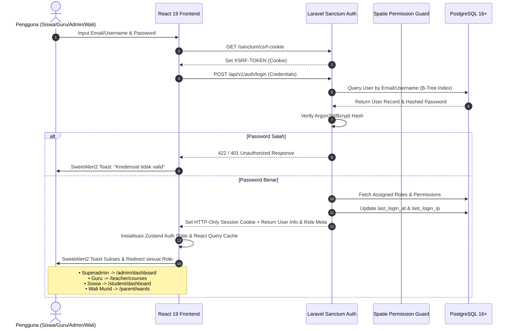
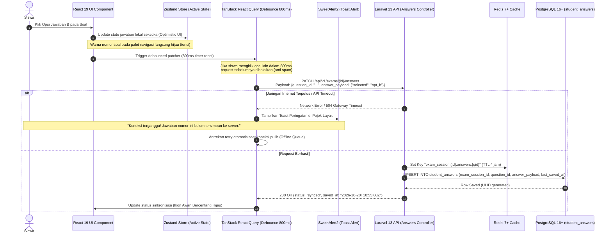
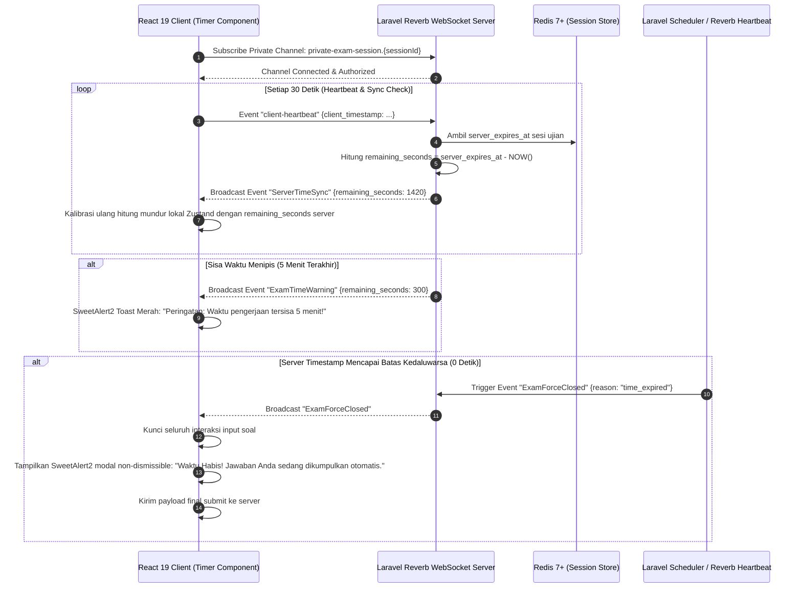
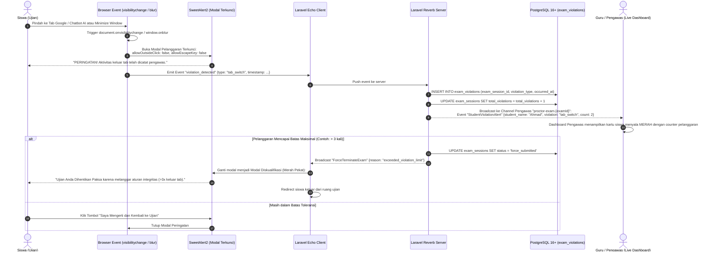
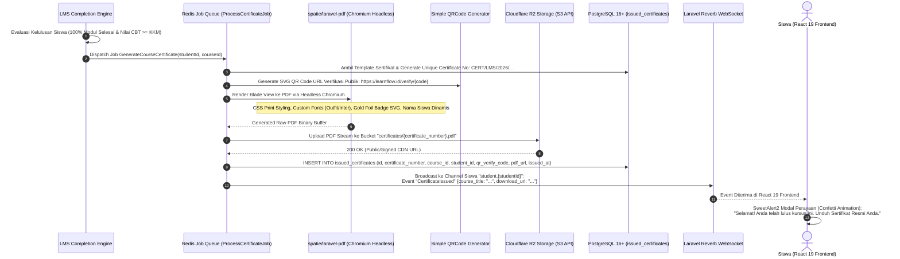

# Flowchart & Sequence Architecture Specification
## E-Learning & Computer Based Testing (CBT) Platform Modern (LearnFlow)

Dokumen ini memetakan seluruh alur kerja (*workflows*), logika interaksi sistem, dan siklus data (*data lifecycle*) dari platform LearnFlow. Seluruh alur dirancang secara modern, modular, dan tangguh (*fault-tolerant*) mengacu pada spesifikasi **Laravel 13 REST API**, **React 19 SPA**, **PostgreSQL 16+**, **Redis 7+**, **Laravel Reverb WebSocket**, dan **SweetAlert2**.

---

## 1. Arsitektur Master Sistem (Decoupled API-First Architecture)

Diagram alir berikut menggambarkan bagaimana komponen Client (React 19), Edge CDN, Laravel 13 Core API, Real-time WebSocket Server, Media Storage, dan Database saling berinteraksi:

```mermaid
flowchart TB
    subgraph CLIENT_LAYER["Frontend Client Layer (React 19 SPA + Vite + TypeScript)"]
        UI["UI & Components (TailwindCSS + Shadcn/ui)"]
        RQ["Data Fetching & Cache (@tanstack/react-query v5)"]
        ZS["Client State Engine (Zustand)"]
        SW["Interactive Dialogs (SweetAlert2)"]
        TT["Rich Text & Math (@tiptap/react + KaTeX)"]
        VP["HLS Video Player (plyr-react)"]
        WS_C["WebSocket Client (laravel-echo + pusher-js)"]
    end

    subgraph EDGE_STORAGE["Edge Media & Storage Infrastructure"]
        R2["Cloudflare R2 (S3-Compatible)
        • Modul PDF & Berkas Tugas
        • Zero Egress Bandwidth"]
        BUNNY["Bunny.net Stream / Cloudflare Stream
        • Multi-resolution HLS (360p-1080p)
        • Token-signed Video Security"]
    end

    subgraph BACKEND_LAYER["Backend Engine (Laravel 13 Headless REST API)"]
        AUTH["Auth & Sanctum Guard (HTTP-Only Cookie / Bearer)"]
        RBAC["Authorization Gate (spatie/laravel-permission)"]
        EXAM_ENG["CBT Core Engine (Randomizer, Timer, Autosave)"]
        MEDIA_LIB["Media Manager (spatie/laravel-medialibrary)"]
        DOC_GEN["Chromium PDF Generator (spatie/laravel-pdf)"]
        EXCEL_ENG["Spreadsheet Engine (maatwebsite/excel)"]
        AUDIT["Audit Trail System (spatie/laravel-activitylog)"]
    end

    subgraph REALTIME_LAYER["Real-Time Engine"]
        REVERB["Laravel Reverb Native WebSocket Server
        • Timer Synchronization
        • Anti-Cheat Event Broadcasting
        • Live Proctoring Dashboard"]
    end

    subgraph DATA_LAYER["Data Persistence & Caching Layer"]
        PG[(PostgreSQL 16+
        • ULID Keys
        • JSONB Questions & Options
        • GIN Indexes & tsvector FTS
        • Strict ACID Transactions)]
        REDIS[(Redis 7+ Cache & Broker
        • Active CBT Session State
        • 800ms Autosave Buffer
        • Job Queue & Broadcast Pub/Sub)]
    end

    %% Client Interactions
    UI <--> ZS
    UI <--> SW
    UI <--> TT
    UI <--> VP
    UI <--> RQ
    RQ <==>|REST API Calls (JSON)| AUTH
    WS_C <==>|WSS Realtime Duplex| REVERB
    
    %% Video & File CDN
    VP <==>|HLS Streaming Playback| BUNNY
    UI <==>|Direct Signed Upload / Download| R2

    %% Backend Integrations
    AUTH --> RBAC
    RBAC --> EXAM_ENG
    RBAC --> MEDIA_LIB
    RBAC --> DOC_GEN
    RBAC --> EXCEL_ENG
    EXAM_ENG -.-> AUDIT
    EXAM_ENG <==>|Pub/Sub Event Broadcast| REVERB
    
    %% Storage & Persistence
    EXAM_ENG <==>|Session & Autosave Caching| REDIS
    EXAM_ENG <==>|ACID Safe Persistence| PG
    MEDIA_LIB <==>|S3 API File Operations| R2
    DOC_GEN ==>|Store Generated PDF| R2
```

---

## 2. Alur Autentikasi, Keamanan Sesi & RBAC

Menggunakan kombinasi **Laravel Sanctum** dengan *HTTP-Only Secure Cookie* untuk browser SPA (mencegah pencurian token via serangan XSS) dan Bearer Token untuk integrasi mobile masa depan, diperkuat hak akses multi-peran **Spatie Permission**.



---

## 3. Alur Kerja Komprehensif CBT Ujian Online (Online Exam Engine)

Siklus hidup pengerjaan ujian dirancang tahan terhadap kecurangan, gangguan koneksi internet, serta manipulasi jam lokal komputer.

```mermaid
flowchart TD
    Start([Siswa Mengakses Halaman Detail Ujian]) --> CheckToken{Ujian Memerlukan Token?}
    CheckToken -- Ya --> InputToken[Siswa Memasukkan Token Ujian]
    InputToken --> RequestSession[Kirim POST /api/v1/exams/:id/start-session]
    CheckToken -- Tidak --> RequestSession

    RequestSession --> ServerValidate{Validasi Server:
    1. Jadwal Ujian Aktif?
    2. Token Sesuai?
    3. Batas IP / Sesi Ganda?}

    ServerValidate -- Tidak Lolos --> DenyAlert[SweetAlert2 Modal Error:
    'Akses Ditolak / Ujian Belum Dibuka']
    DenyAlert --> EndFail([Batal Masuk Ujian])

    ServerValidate -- Lolos Validasi --> InitSession[Backend Laravel:
    1. Buat / Ambil Record exam_sessions
    2. Hitung server_expires_at = NOW + duration
    3. Simpan Sesi & Waktu Kedaluwarsa di Redis
    4. Acak Urutan Soal & Opsi Jawaban (Seeded Random)
    5. Strip Semua answer_keys dari Payload Soal]

    InitSession --> DeliverPayload[Response API ke Frontend React:
    • List Soal Dinamis (options JSONB)
    • Sisa Waktu Ujian dalam Detik (Server Timestamp)
    • Session Token & Config Anti-Cheat]

    DeliverPayload --> StartExamUI[Frontend React:
    1. Masuk Mode Fullscreen Terkunci
    2. Nyalakan Event Listener: visibilitychange & blur
    3. Inisialisasi Countdown Timer di Zustand
    4. Connect ke Laravel Reverb Channel 'exam.{sessionId}']

    StartExamUI --> ExamRunning{Siklus Pengerjaan Ujian}

    %% Sub-alur Pengerjaan
    ExamRunning -->|Siswa Klik Jawaban| AutosaveFlow[Debounced Autosave Flow:
    1. Update State Lokal Zustand
    2. React Query kirim PATCH /api/v1/exams/:id/answers (Debounce 800ms)
    3. Simpan ke Redis Buffer -> Commit ke student_answers]

    ExamRunning -->|Siswa Berpindah Tab / Blur| AntiCheatFlow[Anti-Cheat Breach Flow:
    1. Tangkap visibilitychange
    2. SweetAlert2 Modal Terkunci (allowOutsideClick: false)
    3. Kirim Violation Log ke Server via Reverb & REST
    4. Counter Pelanggaran Bertambah]

    ExamRunning -->|Timer Server Habis| AutoForceSubmit[Otomatis Submit Paksa oleh Server:
    Laravel Reverb Broadcast 'ExamTimedOut' -> Kunci Layar]

    ExamRunning -->|Siswa Klik Selesai Ujian| PreSubmitConfirm[Proteksi Submit SweetAlert2:
    Hitung Soal Terisi vs Belum Dijawab]

    PreSubmitConfirm --> CheckAllAnswered{Semua Soal Sudah Dijawab?}
    CheckAllAnswered -- Belum (Ada Sisa) --> WarnModal[SweetAlert2 Modal Warning:
    'Perhatian! Masih ada X nomor belum dijawab.
    Yakin ingin mengumpulkan sekarang?']
    CheckAllAnswered -- Lengkap --> ReadyModal[SweetAlert2 Modal Konfirmasi:
    'Seluruh nomor telah dijawab. Kumpulkan jawaban Anda?']

    WarnModal --> ConfirmSubmitDecision{Siswa Konfirmasi?}
    ReadyModal --> ConfirmSubmitDecision
    ConfirmSubmitDecision -- Batal --> ExamRunning
    ConfirmSubmitDecision -- Ya, Kumpulkan --> FinalSubmitAPI[POST /api/v1/exams/:id/submit]
    AutoForceSubmit --> FinalSubmitAPI

    FinalSubmitAPI --> GradingEngine[Grading Engine Backend:
    1. DB::transaction() dengan pessimistic lock
    2. Evaluasi Otomatis Soal Objektif (PG, PG Kompleks, Menjodohkan)
    3. Tandai Soal Esai untuk Manual Review Guru
    4. Hitung Nilai Akhir & Simpan ke exam_grades
    5. Update Status exam_sessions = 'submitted'
    6. Hapus Cache Sesi Ujian di Redis]

    GradingEngine --> ShowResult[Frontend React:
    SweetAlert2 Modal Hasil Ujian & Rekap Skor Kelulusan]
    ShowResult --> Finish([Selesai])
```

---

## 4. Diagram Sequence: Debounced Autosave Jawaban Siswa

Alur ini mengilustrasikan mekanisme penghematan beban I/O database saat ribuan siswa memilih jawaban secara serentak, dilengkapi perlindungan *offline/network drop*.



---

## 5. Diagram Sequence: Sinkronisasi Waktu Sisi Server (Server-Authoritative Timer)

Mencegah kecurangan siswa yang mengubah waktu atau zona waktu pada sistem operasi laptop mereka untuk memperpanjang durasi ujian.



---

## 6. Alur Deteksi Pelanggaran Anti-Cheat & Live Proctoring

Diagram penanganan integritas ujian real-time saat siswa mencoba mencari jawaban di tab browser lain, aplikasi eksternal, atau bantuan AI.



---

## 7. Alur Evaluasi Otomatis (Auto-Grading) & Penilaian Esai Guru

Menjamin akurasi penilaian gabungan antara soal objektif instan dan soal esai subjektif yang memerlukan rubrik penilaian guru.

```mermaid
flowchart TD
    SubmitTrigger([Pengumpulan Ujian Final]) --> LockSession[Kunci Sesi Ujian: status = 'submitted']
    LockSession --> StartTransaction[Mulai DB::transaction dengan Pessimistic Lock]

    StartTransaction --> FetchQuestions[Ambil Daftar Jawaban Siswa & Kunci Jawaban Soal]
    
    FetchQuestions --> LoopQuestions{Iterasi Setiap Butir Soal}

    LoopQuestions -->|Tipe: Single Choice| EvalSC{Opsi Sama dengan Kunci?}
    EvalSC -- Benar --> FullPointSC[Beri Poin Penuh]
    EvalSC -- Salah --> ZeroPointSC[Beri Poin 0]

    LoopQuestions -->|Tipe: Multiple Choice Complex| EvalMCC{Cek Opsi Terpilih vs Array Kunci}
    EvalMCC -- Sempurna --> FullPointMCC[Beri Poin Penuh]
    EvalMCC -- Sebagian Benar --> PartialMCC[Hitung Bobot Parsial jika partial_scoring: true]
    EvalMCC -- Semua Salah --> ZeroPointMCC[Beri Poin 0]

    LoopQuestions -->|Tipe: Menjodohkan| EvalPairs[Hitung Rasio Pasangan Kiri & Kanan yang Cocok]
    
    LoopQuestions -->|Tipe: Esai / Uraian| FlagEssay[Tandai is_evaluated = false
    Masukkan ke Antrean Koreksi Guru]

    FullPointSC --> AccumulateScore[Akumulasi Total Skor Objektif]
    ZeroPointSC --> AccumulateScore
    FullPointMCC --> AccumulateScore
    PartialMCC --> AccumulateScore
    ZeroPointMCC --> AccumulateScore
    EvalPairs --> AccumulateScore
    FlagEssay --> AccumulateScore

    AccumulateScore --> CheckAnyEssay{Ada Soal Esai dalam Ujian?}
    
    CheckAnyEssay -- Tidak (Semua Objektif) --> FinalizeGrade[Hitung Nilai Skala 100:
    Simpan ke exam_grades dengan status Lulus/Tidak]
    FinalizeGrade --> CommitDB[Commit Transaksi Database]

    CheckAnyEssay -- Ya (Terdapat Esai) --> ProvisionalGrade[Simpan Nilai Sementara Soal Objektif
    Notifikasi Guru: 'Perlu Koreksi Manual']
    ProvisionalGrade --> CommitDB

    CommitDB --> TeacherReviews([Guru Membuka Ruang Koreksi])
    TeacherReviews --> ReadSubmission[Guru Membaca Jawaban Esai Siswa]
    ReadSubmission --> FillRubric[Guru Memasukkan Skor per Indikator Rubrik & Feedback]
    FillRubric --> SaveTeacherScore[POST /api/v1/exams/:id/grade-essay]
    SaveTeacherScore --> AuditLog[Spatie ActivityLog Mencatat Riwayat Input Nilai Guru]
    AuditLog --> RecomputeFinalGrade[Rekalkulasi Total Skor Akhir (Objektif + Esai)]
    RecomputeFinalGrade --> UpdateFinalGrade[Update exam_grades.final_score]
    UpdateFinalGrade --> NotifyStudent[Kirim Notifikasi Real-time & Email ke Siswa / Wali Murid]
```

---

## 8. Alur Penerbitan Sertifikat Kelulusan Otomatis (PDF & R2 Storage)

Menggunakan **Spatie Laravel PDF** berbasis Chromium headless untuk menghasilkan sertifikat kelulusan beresolusi tinggi dengan kode QR verifikasi publik anti-pemalsuan.



---

## 9. Alur Impor Bank Soal Spreadsheet & Ekspor Nilai (Maatwebsite Excel)

Menjamin pengajar dapat mengunggah ratusan butir soal secara massal dengan validasi skema yang ketat sebelum tersimpan ke database.

```mermaid
flowchart TD
    subgraph IMPORT_FLOW["Alur Impor Massal Bank Soal (XLSX / CSV)"]
        TeacherFile[Guru Mengunggah File Template Excel Bank Soal] --> SendImportAPI[POST /api/v1/question-banks/:id/import-excel]
        SendImportAPI --> ExcelValidation{Validasi Header & Format Kolom:}
        ExcelValidation -- Kolom Tidak Sesuai / Format Rusak --> ReturnImportErrors[Kembalikan Error Detail per Baris & Kolom:
        SweetAlert2 Modal Rekap Kesalahan]
        ExcelValidation -- Valid --> ParseRows[Konversi Setiap Baris ke Struktur JSONB PostgreSQL:
        • Opsi A-E -> JSONB options
        • Kunci Jawaban -> JSONB answer_keys
        • Formula KaTeX di-escape aman]
        ParseRows --> BatchInsert[DB::table 'questions' insert batch (100 baris/chunk)]
        BatchInsert --> ImportComplete[SweetAlert2 Sukses: '150 butir soal berhasil diimpor!']
    end

    subgraph EXPORT_FLOW["Alur Ekspor Rekapitulasi Nilai Ujian (XLSX)"]
        TeacherExport[Guru Klik Tombol 'Ekspor Rekap Nilai'] --> RequestExport[GET /api/v1/exams/:id/export-grades]
        RequestExport --> DispatchExportJob[Dispatch Background Job via Redis Queue]
        DispatchExportJob --> QueryGrades[PostgreSQL Join: users, exam_grades, student_answers]
        QueryGrades --> FormatExcel[Maatwebsite Excel Formatting:
        • Kolom Data Siswa, Nilai per Soal, Nilai Akhir, Status Lulus
        • Styling Tabel, Auto-size Kolom, Highlight Warna KKM]
        FormatExcel --> SaveTempR2[Simpan File Spreadsheet ke Cloudflare R2]
        SaveTempR2 --> NotifyTeacherReverb[Kirim Link Download ke Browser Guru via Reverb WebSocket]
        NotifyTeacherReverb --> AutoDownload[Browser Guru Otomatis Mengunduh File XLSX]
    end
```

Seluruh diagram alir dan sequence ini merepresentasikan arsitektur e-learning dan CBT modern yang tangguh, aman, dan siap melayani lonjakan beban ujian serentak ribuan pengguna.
