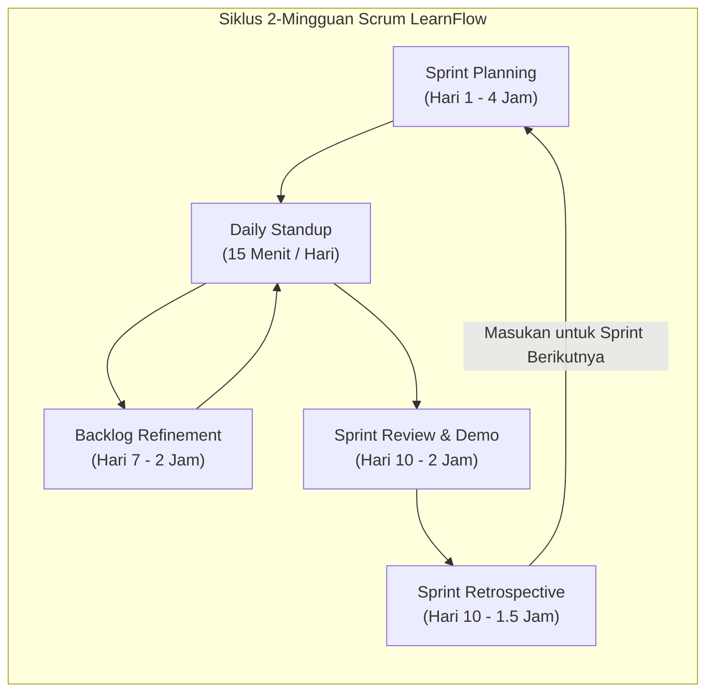
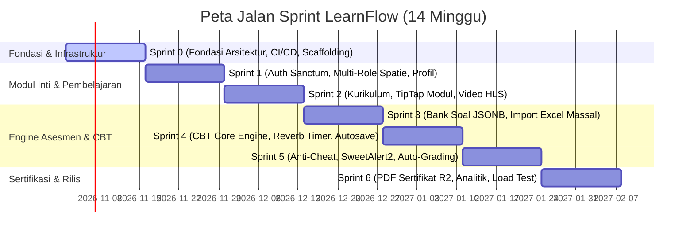

# Agile Scrum Framework & Master Roadmap
## E-Learning & Computer Based Testing (CBT) Platform Modern (LearnFlow)

Dokumen ini mendefinisikan metodologi pengembangan perangkat lunak berbasis **Agile Scrum Framework** untuk pembangunan platform LearnFlow dari inisiasi hingga rilis *production-ready*. Seluruh pembagian sprint didasarkan pada dokumen arsitektur [ERD.md](file:///c:/laragon/www/LearnFlow/plan/ERD.md), [FLOWCHART.md](file:///c:/laragon/www/LearnFlow/plan/FLOWCHART.md), dan [ARCHITECTURE_SYSTEM_DESIGN.md](file:///c:/laragon/www/LearnFlow/plan/ARCHITECTURE_SYSTEM_DESIGN.md).

---

## 1. Parameter Tata Kelola Scrum (Scrum Governance)

### 1.1. Irama Kerja & Durasi Sprint
- **Sprint Cadence**: 2 Minggu (10 hari kerja) per Sprint.
- **Total Durasi Pengembangan**: 14 Minggu (Sprint 0 s.d. Sprint 6).
- **Kapasitas Rata-rata Tim (Velocity)**: 70 – 85 Story Points (SP) per Sprint.
- **Skala Estimasi**: Deret Fibonacci (`1`, `2`, `3`, `5`, `8`, `13`).
  - `1 - 2 SP`: Tugas minor (konfigurasi sederhana, penyesuaian styling, migrasi field tunggal).
  - `3 - 5 SP`: Fitur standar (CRUD controller, komponen form Zod, endpoint REST baru).
  - `8 SP`: Fitur kompleks (engine autosave, integrasi WebSocket Reverb, TipTap custom nodes).
  - `13 SP`: Fitur epik tingkat tinggi (harus dipecah menjadi sub-stories).

### 1.2. Susunan Tim & Peran (Roles & Responsibilities)
1. **Product Owner (PO)**: Bertanggung jawab atas Product Backlog, prioritas fitur, dan validasi *User Acceptance Testing* (UAT).
2. **Scrum Master (SM)**: Memfasilitasi upacara Scrum, menghapus *blocker/impediments*, dan memastikan kepatuhan standar Agile.
3. **Backend Engineers (Laravel & Database Specialist)**: Implementasi REST API Laravel 13, migrasi PostgreSQL 16+, optimasi GIN index, integrasi Spatie packages, Reverb WebSocket, dan Redis cache.
4. **Frontend Engineers (React & UI/UX Specialist)**: Implementasi React 19 SPA, TailwindCSS + Shadcn/ui, TanStack Query, Zustand, SweetAlert2 dialogs, TipTap editor, dan Plyr video player.
5. **Quality Assurance (QA / SDET)**: Pengujian otomatis (PHPUnit, Pest, Cypress/Playwright), pengujian beban (K6), dan verifikasi kriteria penerimaan.
6. **DevOps & Cloud Engineer**: Otomasi CI/CD, konfigurasi Cloudflare R2, Bunny.net Stream, Redis, dan PostgreSQL 16+ di server produksi.

---

## 2. Upacara Scrum (Scrum Ceremonies)

1. **Sprint Planning (Hari 1)**: Memilih User Story dari Product Backlog, mengonfirmasi estimasi poin, dan menyepakati *Sprint Goal*.
2. **Daily Standup (Tiap Pagi, 15 Menit)**: 3 Pertanyaan inti: Apa yang selesai kemarin? Apa target hari ini? Apa hambatan (*blockers*)?
3. **Backlog Refinement / Grooming (Pertengahan Sprint)**: Membedah User Story untuk sprint berikutnya agar memenuhi standar *Definition of Ready (DoR)*.
4. **Sprint Review & Demo (Hari Terakhir)**: Demonstrasi software berjalan yang telah lulus *Definition of Done (DoD)* di hadapan pemangku kepentingan.
5. **Sprint Retrospective (Hari Terakhir)**: Evaluasi proses kerja tim: *What went well*, *What could be improved*, *Action items*.

---

## 3. Standar Kualitas Kerja: DoR & DoD

### 3.1. Definition of Ready (DoR) - Sebelum Masuk Sprint
Sebuah User Story baru dapat ditarik ke Sprint Backlog jika:
- [x] Dituliskan dengan format standar: *As a [role], I want [feature], so that [benefit]*.
- [x] Memiliki kriteria penerimaan terukur (*Acceptance Criteria*) berbasis pola *Given-When-Then*.
- [x] Desain UI/UX (Figma wireframe/mockup) telah final dan disetujui.
- [x] Kontrak API awal (request/response schema) telah didefinisikan.
- [x] Diestimasi oleh tim pengembang dan tidak melebihi 8 Story Points.
- [x] Tidak ada dependensi eksternal yang belum terselesaikan.

### 3.2. Definition of Done (DoD) - Sebelum Ditutup
Sebuah User Story dinyatakan selesai (*Done*) jika:
- [x] Kode program lulus *linting* (Pint / ESLint) tanpa error atau warning.
- [x] Seluruh kriteria penerimaan (*Acceptance Criteria*) terpenuhi dan lolos verifikasi QA.
- [x] Unit test dan Feature test dibuat dengan *code coverage* minimal 85%.
- [x] Endpoint API terdokumentasi otomatis via `dedoc/scramble` di `/docs/api`.
- [x] Perubahan skema database telah menyertakan migrasi PostgreSQL 16+ idempotent dan rollback script.
- [x] Komponen dialog menggunakan standar `SweetAlert2` yang ditentukan.
- [x] *Pull Request (PR)* direview dan disetujui minimal oleh 2 peer engineer.
- [x] Berhasil di-*merge* dan dideploy ke lingkungan *Staging* tanpa insiden.

---

## 4. Peta Jalan Sprint (Master Sprint Roadmap)

### Rangkuman Pembagian Sprint:

| Sprint | Judul Sprint | Fokus & Deliverable Utama | Target Story Points | Dokumen Detail |
| :---: | :--- | :--- | :---: | :--- |
| **Sprint 0** | **Fondasi Arsitektur, Infrastruktur & Scaffolding** | Setup Laravel 13, React 19 Vite, PostgreSQL 16+ ULID base, Redis 7+, Cloudflare R2, Bunny.net, Reverb, CI/CD. | 75 SP | [SPRINT_0.md](file:///c:/laragon/www/LearnFlow/plan/sprint/SPRINT_0.md) |
| **Sprint 1** | **Autentikasi Sanctum, Multi-Peran Spatie & Profil** | SPA HTTP-only cookie auth, RBAC 5 role, profil, upload avatar R2, portal wali murid, audit log auth. | 78 SP | [SPRINT_1.md](file:///c:/laragon/www/LearnFlow/plan/sprint/SPRINT_1.md) |
| **Sprint 2** | **Kurikulum Akademik, Modul TipTap & Video HLS** | Kursus, modul, pelajaran, editor TipTap + KaTeX LaTeX, streaming video HLS Plyr, pelacakan progres, forum FTS. | 82 SP | [SPRINT_2.md](file:///c:/laragon/www/LearnFlow/plan/sprint/SPRINT_2.md) |
| **Sprint 3** | **Bank Soal Dinamis JSONB & Impor Massal Excel** | Bank soal 6 tipe (PG, PG Kompleks, Menjodohkan, Esai, Likert), GIN index, Maatwebsite Excel import dengan validasi Zod/FormRequest. | 80 SP | [SPRINT_3.md](file:///c:/laragon/www/LearnFlow/plan/sprint/SPRINT_3.md) |
| **Sprint 4** | **Engine Ujian CBT, WebSocket Reverb & Debounced Autosave** | Pengacakan soal/opsi ber-seed, server-authoritative timer, TanStack Query debounced autosave (800ms), buffer Redis, navigasi palet soal Zustand. | 85 SP | [SPRINT_4.md](file:///c:/laragon/www/LearnFlow/plan/sprint/SPRINT_4.md) |
| **Sprint 5** | **Anti-Cheat Terkunci, Dialog SweetAlert2 & Auto-Grading** | Deteksi `visibilitychange`/blur, modal SweetAlert2 terkunci, Reverb live proctoring, auto-grading ACID, penilaian rubrik esai guru. | 84 SP | [SPRINT_5.md](file:///c:/laragon/www/LearnFlow/plan/sprint/SPRINT_5.md) |
| **Sprint 6** | **Sertifikat Kelulusan R2, Analitik, Load Testing & Rilis** | Spatie Laravel PDF Chromium generator, QR verify publik, ekspor nilai Excel, stress test K6 1000 concurrent user, security hardening. | 76 SP | [SPRINT_6.md](file:///c:/laragon/www/LearnFlow/plan/sprint/SPRINT_6.md) |

---

## 5. Indeks Berkas Sprint

Navigasi cepat ke detail setiap sprint:
- **[SPRINT_0.md](file:///c:/laragon/www/LearnFlow/plan/sprint/SPRINT_0.md)** — Arsitektur & Setup Fondasi
- **[SPRINT_1.md](file:///c:/laragon/www/LearnFlow/plan/sprint/SPRINT_1.md)** — Autentikasi & Otorisasi RBAC
- **[SPRINT_2.md](file:///c:/laragon/www/LearnFlow/plan/sprint/SPRINT_2.md)** — Manajemen Kurikulum & Media Belajar
- **[SPRINT_3.md](file:///c:/laragon/www/LearnFlow/plan/sprint/SPRINT_3.md)** — Bank Soal PostgreSQL JSONB & Impor Excel
- **[SPRINT_4.md](file:///c:/laragon/www/LearnFlow/plan/sprint/SPRINT_4.md)** — CBT Engine, WebSocket Timer & Autosave
- **[SPRINT_5.md](file:///c:/laragon/www/LearnFlow/plan/sprint/SPRINT_5.md)** — Anti-Cheat Proctoring, SweetAlert2 & Penilaian
- **[SPRINT_6.md](file:///c:/laragon/www/LearnFlow/plan/sprint/SPRINT_6.md)** — Sertifikasi Chromium, Analitik & Peluncuran
